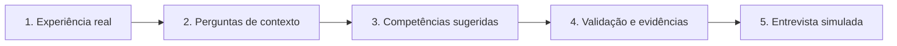

# ✨ potencIA | Jornada Profissional

### Da experiência real ao reconhecimento de competências

**🏆 1º lugar | Prêmio Estagiário Inovador CIEE 2026**

**Inteligência Artificial • Desenvolvimento Profissional • Juventude • Inclusão**

> **A potencIA não inventa competências. Ela ajuda o jovem a reconhecer e demonstrar seu potencial real.**

---

## 💡 Sobre o projeto

A **potencIA** é uma proposta de plataforma web que utiliza inteligência artificial para apoiar jovens no início da vida profissional. A jornada parte de experiências reais, mesmo fora de empregos formais, e ajuda a identificar competências, organizar evidências e preparar apresentações em entrevistas.

O projeto foi criado por **Luis Fernando Pereira da Silva**, estudante de Análise e Desenvolvimento de Sistemas, e conquistou o **1º lugar no Prêmio Estagiário Inovador do CIEE em 2026**, apresentado na EXPO CIEE, em São Paulo.

> **Estágio do projeto:** protótipo demonstrativo e proposta de evolução. As telas de apresentação ilustram a experiência planejada e não representam, necessariamente, funções já integradas ou disponíveis em produção.

## 🎯 O problema

Muitos jovens realizam atividades em projetos escolares, na comunidade, no comércio familiar ou no dia a dia, mas têm dificuldade para explicar o que aprenderam e como essas vivências se relacionam com o mercado de trabalho.

### 📊 Pesquisa inicial: 40 respostas válidas

| Indicador da pesquisa | Resultado |
|:--|--:|
| Já deixaram de buscar uma oportunidade por insegurança sobre suas experiências e competências | **80%** |
| Teriam mais confiança se conseguissem demonstrar competências na prática | **87,5%** |
| Afirmaram que utilizariam a potencIA | **77,5%** |

**Nota:** são respostas de uma pesquisa exploratória com participantes do projeto. Não comprovam impacto ou eficácia da ferramenta.

## 🤖 Como funciona a jornada proposta

A assistente virtual **Lia** acompanha a proposta de jornada, fazendo perguntas para compreender o papel do jovem nas situações relatadas. A IA **sugere**, mas o jovem **confirma, ajusta ou rejeita** as competências. O objetivo é evitar atribuir qualificações sem base nas experiências.

### Funcionalidades apresentadas no conceito

- **Descoberta de competências:** identificação orientada a partir de relatos reais.
- **Entrevista simulada:** preparação para explicar experiências e habilidades.
- **Currículo inteligente:** organização das competências relevantes para candidaturas.
- **Plano de evolução:** metas e acompanhamento de desenvolvimento.
- **Vagas e oportunidades:** uma possibilidade de conexão futura com oportunidades.

Essas funcionalidades estão em diferentes etapas de concepção e prototipagem; não devem ser interpretadas como uma plataforma já implantada integralmente.

## 🖥️ O protótipo deste repositório

**Tecnologias documentadas no projeto:**
- HTML5
- CSS3
- JavaScript

**Execução local:** baixe ou clone o repositório e abra o arquivo `index.html` no navegador, quando disponível na versão consultada.

O protótipo é uma demonstração da proposta, não um serviço de orientação profissional validado em larga escala.

### 📸 Telas e apresentação

A apresentação da grande final do CIEE 2026 inclui cinco imagens selecionadas para compor esta documentação:

| Material | Conteúdo |
|:--|:--|
| **Plataforma** | Painel da potencIA e visão da experiência proposta |
| **Jornada com a Lia** | Relato de experiência e identificação de competências |
| **Resultados da pesquisa** | Principais números das 40 respostas |
| **Piloto planejado** | Objetivos da proposta de teste com 50 jovens |
| **Mensagem final** | Propósito de reconhecer o potencial real |

<!-- Imagens selecionadas da apresentação de 8 slides. Após adicioná-las em docs/imagens/, inserir aqui:

-->

## 📈 Como pretendemos avaliar a evolução

A proposta inclui um **formulário inicial** para registrar confiança, percepção das próprias competências e preparo para entrevistas; acompanhamento durante o uso; e **formulário final** para comparar as percepções.

O **piloto com 50 jovens é planejado**, com foco em validar a experiência, coletar feedbacks, identificar dificuldades e aprimorar a solução. **Ele ainda não é apresentado como realizado.**

## 🌱 Acesso e sustentabilidade

A visão do projeto é oferecer acesso gratuito aos jovens por meio de uma plataforma web, buscando parcerias com instituições e empresas para apoiar sua continuidade. Uma versão em aplicativo é uma possibilidade futura.

## 🛡️ Privacidade e responsabilidade

- Não publicar dados pessoais ou respostas identificáveis da pesquisa.
- Permitir que o jovem revise as competências sugeridas.
- Não inventar experiências, cargos, certificações ou resultados.
- Tratar a IA como ferramenta de apoio, e não como substituta de profissionais de orientação ou recrutamento.

## 🛣️ Próximos passos

1. Evoluir o protótipo e priorizar as funcionalidades principais.
2. Aprofundar a validação das competências e das evidências práticas.
3. Melhorar a simulação de entrevistas.
4. Planejar e executar o piloto com 50 jovens, mediante cuidados com os dados.
5. Medir resultados e avaliar parcerias para continuidade.

## 👨‍💻 Idealizador

**Luis Fernando Pereira da Silva**

[GitHub](https://github.com/luisfernandops-dev) · [LinkedIn](https://www.linkedin.com/in/luis-fernando-dev06/)

---

**potencIA | Jornada Profissional**

*Porque todo jovem merece uma oportunidade de mostrar do que é capaz.*

